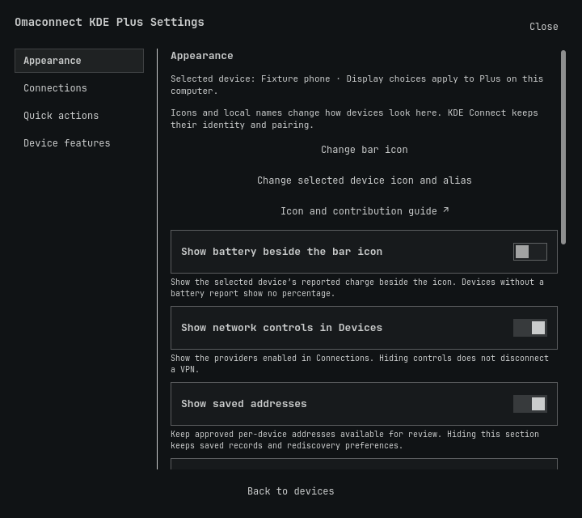

# Omaconnect KDE Plus

A KDE Connect companion for the [Omarchy](https://omarchy.org/) bar: send files,
run your own quick actions and choose how your devices look. It is a fork of
[Jitendra Dara’s OmaConnect](https://github.com/jitendradara12/omaconnect), built
on [KDE Connect](https://kdeconnect.kde.org/).



[](https://github.com/ryan-winkler/omaconnect-kde-plus/actions/workflows/validate.yml)
[](https://github.com/ryan-winkler/omaconnect-kde-plus/actions/workflows/codeql.yml)

## Install

**Existing Plus through 0.1.2:** follow the [ID migration guide](docs/INSTALL.md#former-uppercase-development-id)
before this fresh-install command. This preserves placement and settings and
avoids a second active Plus copy.

```bash
omarchy pkg add kdeconnect python python-gobject
omarchy plugin add https://github.com/ryan-winkler/omaconnect-kde-plus.git --enable
```

Open the new bar icon, select **Native KDE Connect settings** and pair your device.
Moving from the original OmaConnect? Read [install, update and recovery](docs/INSTALL.md)
first and add Plus without `--enable`. The plugin ID is `omaconnect.plus`.

## Features

- **Files:** pick up to 100 files with the desktop file chooser, or drop them on
  the Devices target, bar icon or Send window. Review the recipient, count and size, then Send.
  Drops copy and never move originals.
- **Honest activity:** “Request accepted” means KDE accepted the transfer;
  delivery stays unknown. A batch keeps its reviewed recipient.
- **Quick actions:** add, remove and reorder reviewed shortcuts, including media
  transport, native KDE Connect routes and an optional Quick Share shortcut.
- **Appearance:** choose a phone, computer, theme icon, symbol or local PNG/SVG,
  and an alias per device. Preview before Apply.
- **Daily layout:** a compact View menu, top or bottom placement, and optional
  Send and Activity shortcuts. Switch devices in one dropdown. Collapse daily
  sections and move every section up or down from Settings. Every view stays available.
- **Settings:** Appearance, Connections, Quick actions and Device features, with
  short help next to each control. Sections can be hidden or collapsed.
- **Device features:** search installed native modules, change their local On/Off
  state with readback, and open their native configuration forms. KDE Connect keeps
  pairing, battery, notifications,
  file browsing, media playback and player switching, remote commands, clipboard,
  text, SMS and remote input.
- **Network access:** optional Tailscale, MikroTik Back to Home and WireGuard
  sections with short guides. Tailscale and WireGuard open their own panel or
  profiles; Plus never connects a VPN itself. An optional card shows your Back
  to Home helper's Automatic / On / Off mode and can ask that helper to change it.
- **Private addresses:** approve LAN or VPN addresses per device, with opt-in
  rediscovery. Existing KDE addresses are preserved.
- **Syncthing notes:** optionally record that a KDE device and a Syncthing ID are
  the same machine, pause or resume syncing with it, and open the existing Syncshell
  panel.

Read the [task guide](docs/HELP.md) for every control.

## Why Plus?

OmaConnect already covers pairing, battery, clipboard, SMS, media and remote
commands. Keep it if its workflow suits you. Plus adds:

| If you need… | Plus adds… |
| --- | --- |
| Your own bar and device look | Icon search, local images, aliases and preview. |
| A normal file workflow | File chooser, multiselect, drops and explicit review. |
| Shortcuts that fit your tasks | Add, remove and reorder actions; Ring is optional. |
| Control over popup navigation | Move the View row, choose direct shortcuts, and reorder or collapse daily sections. |
| Every native feature in reach | Searchable installed modules, native On/Off readback and per-device configuration links. |
| Your existing remote access | Separate Tailscale, Back to Home and WireGuard opt-ins. |

## Requirements

Omarchy, KDE Connect, Python 3 with PyGObject and a desktop file portal. The
optional home-access card needs your own `remote-access-mode` helper (path
configurable). Plus does not ship or install that helper. Opening Syncthing
needs the `io.github.ilyazar.syncthing` plugin.
The Quick Share shortcut opens RQuickShare (`r-quick-share` package); Plus does
not speak Quick Share itself.
Missing optional providers stay unavailable; Plus never installs them.

## Privacy

Appearance and address metadata stay in owner-only files. Typed text, Ping
messages and the paths of files you send travel over stdin and D-Bus, never
process arguments. Saved settings, such as a default Ping message, go through
Omarchy, which briefly passes them in process arguments. Do not save private
text there. Files in shared locations are sent from a private snapshot. Activity
keeps at most 50 summaries in memory, without paths. Media shows track text and
controls but never loads provider-supplied album art.

## Contributing

Code, docs, design, accessibility and device testing are all welcome. Start with
[CONTRIBUTING.md](CONTRIBUTING.md) and run `./scripts/validate.sh`. Ask questions in
[Discussions](https://github.com/ryan-winkler/omaconnect-kde-plus/discussions),
see [SUPPORT.md](SUPPORT.md) for help, and report vulnerabilities privately through
[SECURITY.md](SECURITY.md). Changes are listed in [CHANGELOG.md](CHANGELOG.md).

## Credits and license

Plus starts from OmaConnect 1.5.0
([`71282d2`](https://github.com/jitendradara12/omaconnect/tree/71282d2042b1a1cda1cb1cac84251694eaabb7cb))
and keeps its history and MIT license. KDE Connect owns pairing, permissions and
the device protocol. The Back to Home card keeps its
[Bananet](https://plugins.omarchy.org/plugin.html?id=banan.bananet) notice in
`BthControlCard.qml`. This is an independent community project, not an official
KDE or Omarchy one. See [AUTHORS.md](AUTHORS.md) and [LICENSE](LICENSE).
