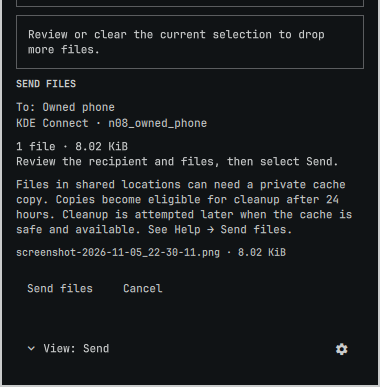
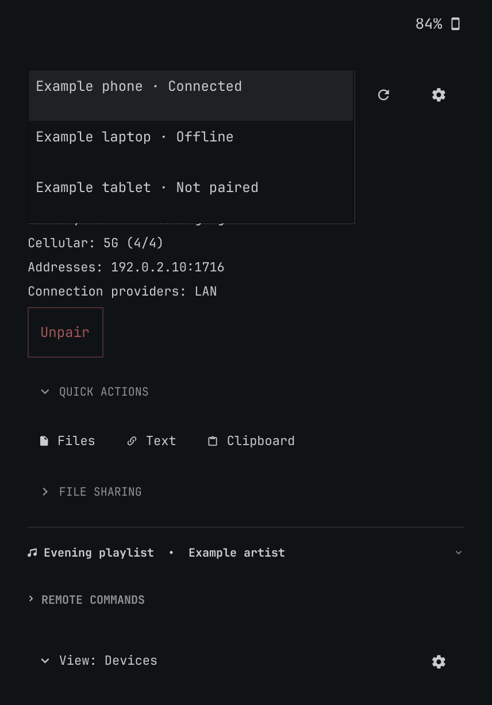
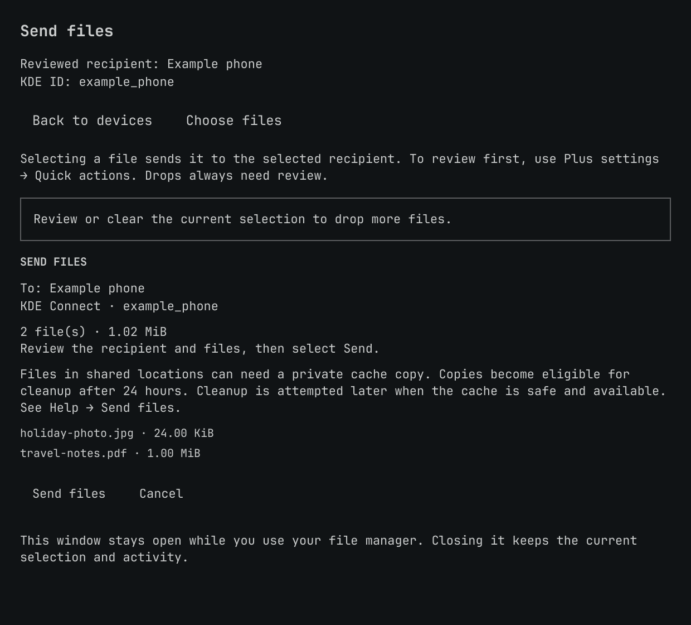
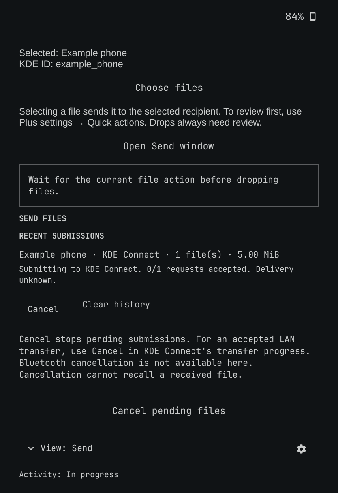
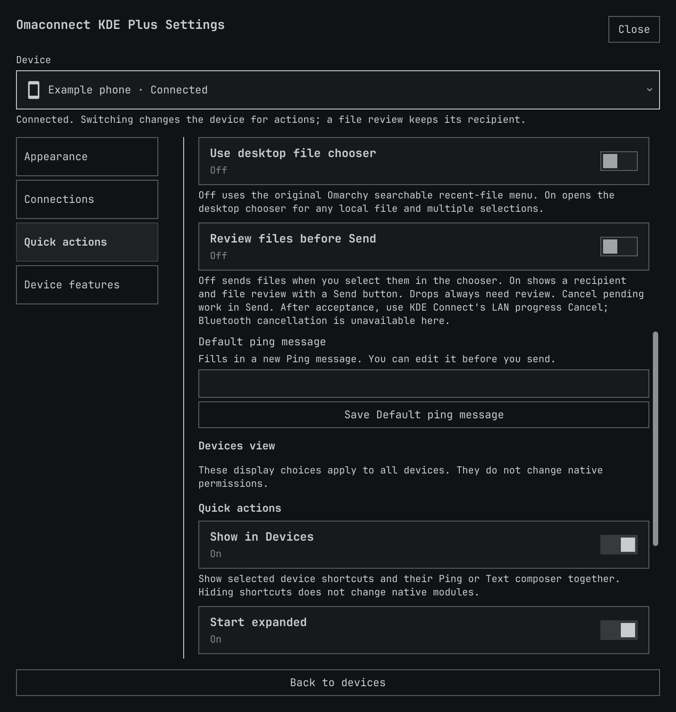
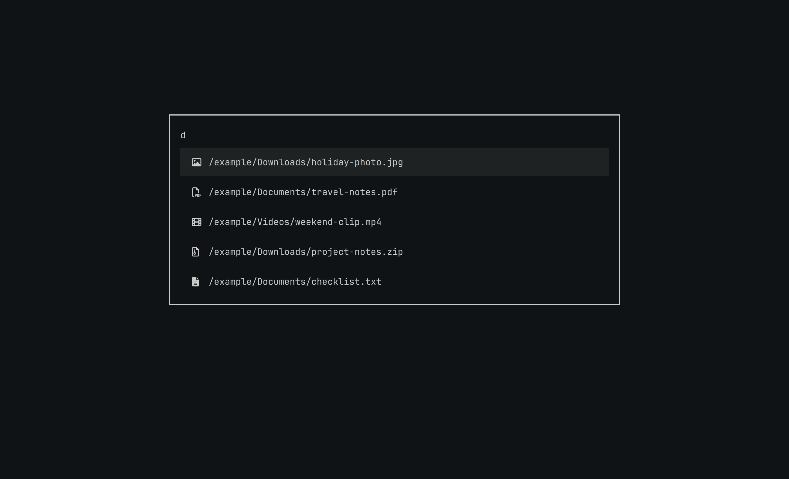
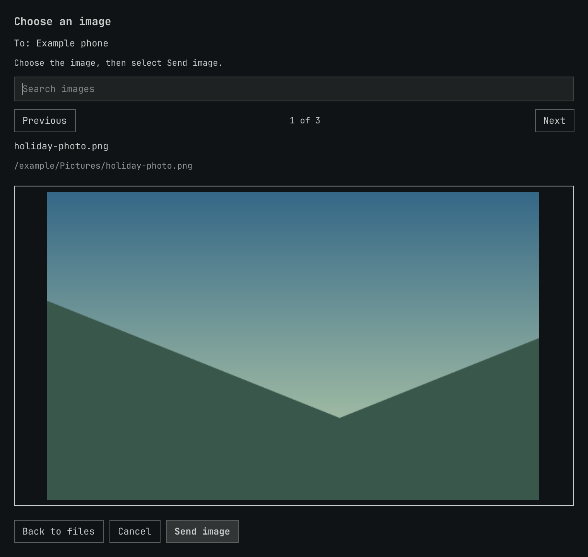
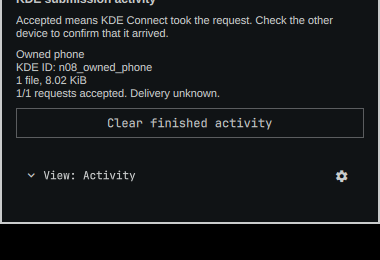

# Omaconnect KDE Plus

Use [KDE Connect](https://kdeconnect.kde.org/) from the
[Omarchy](https://omarchy.org/) bar. Send files, browse shared phone folders
and put the quick actions you use most within reach.

Omaconnect KDE Plus is a fork of
[Jitendra Dara’s OmaConnect](https://github.com/jitendradara12/omaconnect).
KDE Connect handles pairing and device communication.



Example devices, files and media are used in the screenshots.
See the [screenshot gallery](docs/HELP.md#screenshots) for the open device dropdown,
phone folders, the layout editor, Send, cancellation, activity, media and all four
settings domains.

[](https://github.com/ryan-winkler/omaconnect-kde-plus/actions/workflows/validate.yml)
[](https://github.com/ryan-winkler/omaconnect-kde-plus/actions/workflows/codeql.yml)

## Install

**Existing Plus through 0.1.2:** follow the [ID migration guide](docs/INSTALL.md#former-uppercase-development-id)
before this fresh-install command. This preserves placement and settings and
avoids a second active Plus copy.

```bash
omarchy pkg add kdeconnect python python-gobject
omarchy plugin add https://github.com/ryan-winkler/omaconnect-kde-plus.git --enable
```

Open the new bar icon. If you need to pair a device, select **Pair in KDE Connect**
or **Open KDE Connect**. If neither button is visible, open **KDE Connect** from
the application launcher. Compare the verification key on both devices before accepting.
Moving from the original OmaConnect? Read [install, update and recovery](docs/INSTALL.md)
first and add Plus without `--enable`. The plugin ID is `omaconnect.plus`.

## Features

- **Files.** Choose up to 100 local files in the desktop chooser. Check the
  files and recipient, then select **Send files**. In **Plus settings → Quick
  actions**, turn off **Review files before Send** to submit when you confirm
  the selection in the chooser. Turn off **Use desktop file chooser** to use the
  searchable Omarchy recent-file menu and **Image previews…**. Drops on Devices,
  the bar icon or Send window always require review and use Copy.
- **Phone folders:** select **Browse phone files** to open folders shared by KDE
  Connect in your default file manager. Add it to Quick actions for direct access
  from Devices. If KDE Connect reports that storage is unmounted, select
  **Phone file settings in KDE** or retry **Browse phone files**. If the button
  cannot open plugin settings, open KDE Connect settings manually. Several
  advertised folders show a choice.
- **Screenshots:** save a capture with Omarchy Screenshot, then use
  **Review saved screenshot** to select one PNG. Check the file and recipient,
  then select **Send files**. The action always opens review.
- **Cancel:** stop pending file work from any daily view or the Send window.
  After native acceptance, use KDE Connect's LAN transfer progress Cancel.
  Bluetooth cancellation is not exposed by the current native sharing API.
- **Honest activity:** “Request accepted” means KDE accepted the transfer;
  delivery stays unknown. A batch keeps its reviewed recipient.
- **Desktop notices:** see final file-request outcomes while Plus is closed.
  Device names are omitted by default; enable them separately in Quick actions
  settings. Native notification history and Do Not Disturb remain with Omarchy.
- **Quick actions:** add, remove and reorder reviewed shortcuts, including media
  transport, native KDE Connect routes and an optional Quick Share shortcut.
- **Appearance:** choose a phone, computer, theme icon, symbol or local PNG/SVG,
  and an alias per device. Preview before Apply.
- **Daily layout:** a compact View menu, top or bottom placement, and optional
  Send and Activity shortcuts. Switch devices in one dropdown. Collapse daily
  sections. Open **Devices → Edit layout** to change visibility and position on
  the actual sections, including hidden ones. Every view stays available.
- **Language and launcher:** Plus follows Omarchy's language and reading direction.
  Missing Plus text falls back to English. The optional
  [application launcher](docs/INSTALL.md#optional-application-launcher)
  opens Devices, Send files or Activity.
- **Settings:** Appearance, Connections, Quick actions and Device features, with
  short help next to each control. Sections can be hidden or collapsed.
- **Device features:** search installed native modules, change their local On/Off
  state with readback, and open their native configuration forms. KDE Connect keeps
  pairing, battery, notifications,
  file browsing, media playback and player switching, remote commands, clipboard,
  text, SMS and remote input.
- **Network access:** optional Tailscale, MikroTik Back to Home and WireGuard
  sections with short guides. Tailscale and WireGuard open their own panel or
  profiles; Plus never connects a VPN itself. An optional card shows your Back
  to Home helper's Automatic / On / Off mode and can ask that helper to change it.
- **Private addresses:** approve LAN or VPN addresses per device, with opt-in
  rediscovery. Existing KDE addresses are preserved.
- **Syncthing notes:** optionally record that a KDE device and a Syncthing ID are
  the same machine, pause or resume syncing with it, and open the existing Syncshell
  panel.

Read the [task guide](docs/HELP.md) for every control.

## Screenshots

Select an image to view it at full size. The [complete gallery](docs/HELP.md#screenshots)
also covers appearance, icon choices, section ordering, connections and native features.

| Open device dropdown | File review and persistent Send window |
| --- | --- |
| [](docs/screenshots/bar-dropdown.png) | [](docs/screenshots/send-review.png) |

| Pending submission and Cancel | Quick actions sharing preferences |
| --- | --- |
| [](docs/screenshots/pending-cancel.png) | [](docs/screenshots/sharing-preferences.png) |

| Recent files with type icons | Guided image previews |
| --- | --- |
| [](docs/screenshots/recent-file-menu.png) | [](docs/screenshots/image-previews.png) |

| Review a saved screenshot | Read the request result |
| --- | --- |
| [](preview.png) | [](docs/screenshots/screenshot-activity.png) |

## Why Plus?

OmaConnect already covers pairing, battery, clipboard, SMS, media and remote
commands. Keep it if its workflow suits you. Plus adds:

| If you need… | Plus adds… |
| --- | --- |
| Your own bar and device look | Icon search, local images, aliases and preview. |
| A choice of file workflows | Original file menu, desktop chooser, multiselect, drops and optional chooser review. |
| Shortcuts that fit your tasks | Add, remove and reorder actions; Ring is optional. |
| Control over popup navigation | Move the View row, choose direct shortcuts, and reorder or collapse daily sections. |
| Every native feature in reach | Searchable installed modules, native On/Off readback and per-device configuration links. |
| Your existing remote access | Separate Tailscale, Back to Home and WireGuard opt-ins. |

## Requirements

Omarchy, KDE Connect, Python 3 with PyGObject and a desktop file portal. The
optional home-access card needs your own `remote-access-mode` helper (path
configurable). Plus does not ship or install that helper. Opening Syncthing
needs the `io.github.ilyazar.syncthing` plugin.
The Quick Share shortcut opens RQuickShare (`r-quick-share` package); Plus does
not speak Quick Share itself.
Missing optional providers stay unavailable; Plus never installs them.

## Privacy

Appearance and address metadata stay in owner-only files. Typed text, Ping
messages and the paths of files you send travel over stdin and D-Bus, never
process arguments during native submission. The optional recent-file menu puts
listed file paths and the recipient name in Omarchy’s process arguments. Other
local accounts may be able to read those arguments. Keep the default desktop
chooser on to avoid that exposure. Saved settings, such as a default Ping
message, go through Omarchy, which briefly passes them in process arguments.
Keep private text out of these saved settings. Files in shared locations are sent from a private snapshot. Activity
keeps at most 50 summaries in memory, without paths. Media shows track text and
controls but never loads provider-supplied album art.

## Contributing

Code, docs, design, accessibility and device testing are all welcome. Read the
[contribution guide](CONTRIBUTING.md) or choose a
[good first issue](https://github.com/ryan-winkler/omaconnect-kde-plus/issues?q=is%3Aissue+is%3Aopen+label%3A%22good+first+issue%22).
Ask questions in [Discussions](https://github.com/ryan-winkler/omaconnect-kde-plus/discussions),
see [SUPPORT.md](SUPPORT.md) for help, and report vulnerabilities privately through
[SECURITY.md](SECURITY.md). Changes are listed in [CHANGELOG.md](CHANGELOG.md).

## Credits and license

Plus starts from OmaConnect 1.5.0
([`71282d2`](https://github.com/jitendradara12/omaconnect/tree/71282d2042b1a1cda1cb1cac84251694eaabb7cb))
and keeps its history and MIT license. [KDE Connect](https://kdeconnect.kde.org/)
owns pairing, permissions and the device protocol. See
[where to contribute upstream](CONTRIBUTING.md#share-reusable-improvements-upstream).
The Back to Home card keeps its
[Bananet](https://plugins.omarchy.org/plugin.html?id=banan.bananet) notice in
`BthControlCard.qml`. This is an independent community project, not an official
KDE or Omarchy one. See [AUTHORS.md](AUTHORS.md) and [LICENSE](LICENSE).
